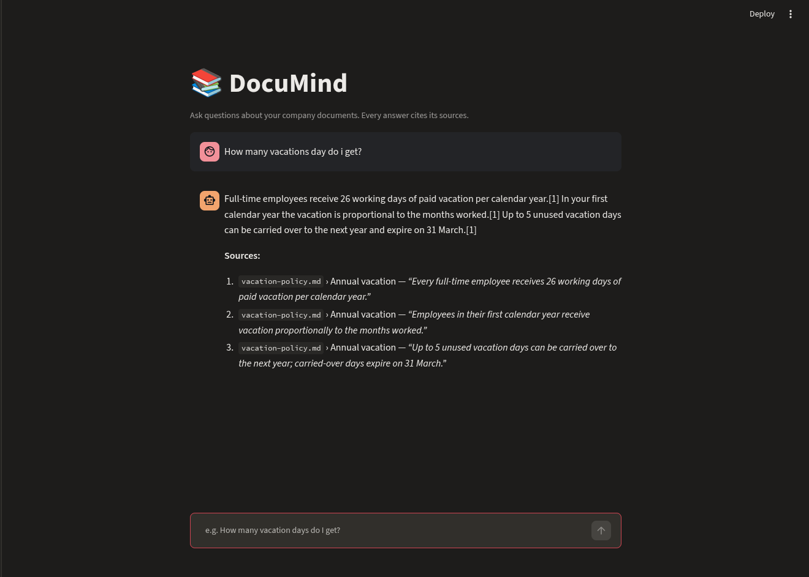

# DocuMind: Q&A over company documents with sources

A Retrieval-Augmented Generation (RAG) assistant: upload internal documents (Markdown, text, PDF) and ask
questions in natural language. Answers are generated by an LLM (**OpenAI** or **Claude**, switchable with
`LLM_PROVIDER`) using **only** the retrieved documents,
and every claim comes with a **citation**: the exact quote and the file it came from.
If the answer is not in the documents, the assistant says so instead of making something up.




## How it works

```
             INGESTION (python -m app.ingest)
 docs/*.md,pdf ──► split by headings ──► chunks (800 chars, 150 overlap) ──► embeddings ──► ChromaDB
                                                                            (local MiniLM)

             QUESTION (POST /ask)
 question ──► embed ──► top-k similar chunks ──► LLM (OpenAI / Claude) ──► answer + verified sources
```

| Part | File | What it does |
|---|---|---|
| Chunking | `app/ingest.py` | Splits documents by markdown headings, then into overlapping pieces |
| Vector store | `app/store.py` | ChromaDB with a free local embedding model (no extra API key) |
| Generation | `app/rag.py` | Calls OpenAI (JSON answer + quotes) or Claude (Citations API); provider set in `.env` |
| API | `app/api.py` | FastAPI: `/ask`, `/documents` (upload + re-index), `/health` |
| UI | `ui/streamlit_app.py` | Chat interface with sources and document upload |
| Evaluation | `evals/` | Measures retrieval hit-rate, answer correctness and citation correctness |
| Tests | `tests/` | Unit tests for chunking logic |

### Design decisions
- **Provider-agnostic.** The LLM is a config switch (`LLM_PROVIDER=openai|anthropic`); retrieval, API, UI and
  evals don't change.
- **Verified citations.** With OpenAI the model returns JSON with quotes, and every quote is checked against the
  source chunk; invented quotes are dropped. With Claude the built-in Citations API returns exact quotes.
- **Chunking by headings first.** A chunk never mixes two policy sections, which improves retrieval precision.
- **Local embeddings.** Free and private; only the top-k chunks are sent to the LLM, not the whole corpus.
- **"I don't know" is a feature.** The eval set includes an unanswerable question to check the model does not hallucinate.
- **Safety fallback (Claude).** If a request is declined by a safety classifier, the API retries on a fallback model (`fallbacks: "default"`).

## Quick start

### With Docker
```bash
cp .env.example .env          # put your OPENAI_API_KEY (or ANTHROPIC_API_KEY) in .env
docker compose up --build
```
- UI: http://localhost:8501
- API docs (Swagger): http://localhost:8000/docs

### Locally
```bash
python -m venv .venv && source .venv/bin/activate
pip install -r requirements.txt
cp .env.example .env          # add your key
python -m app.ingest          # index data/docs
uvicorn app.api:app --reload  # terminal 1
streamlit run ui/streamlit_app.py   # terminal 2
```

Quick CLI check: `python -m app.rag "How many vacation days do I get?"`

### Example
```bash
curl -s localhost:8000/ask -H 'content-type: application/json' \
  -d '{"question": "Can I work from Spain for a few weeks?"}'
```

## Evaluation

```bash
python -m evals.run_evals --retrieval-only   # free, no API calls
python -m evals.run_evals                    # end-to-end with the LLM
pytest
```

The eval set (`evals/questions.jsonl`) has 15 questions: factual questions per document and one that cannot
be answered from the documents (the assistant must say it doesn't know).

| Metric | Result |
|---|---|
| Retrieval hit@4 | 14/14 (100%) |
| Answer contains expected fact | 15/15 (100%) — `gpt-5-mini` |
| Answer cites the correct document | 15/15 (100%) — `gpt-5-mini` |

## Limitations
- **English only.** Documents and questions should be in English (see Next steps).

## Sample data
`data/docs/` contains a fictional company handbook (vacation policy, IT security, onboarding, cloud cost
guidelines). Replace it with your own documents or upload them through the UI.

## Next steps / ideas
- Hybrid search (BM25 + vectors) and a re-ranker for larger document sets
- Multilingual support: the current embedding model (all-MiniLM-L6-v2) is English-only, so questions in
  other languages retrieve the wrong chunks; a multilingual model (e.g. via `fastembed`) would fix this
- Streaming answers in the UI
- Deploy to Azure Container Apps / AWS App Runner
- LLM-as-judge grading in the eval instead of keyword matching
